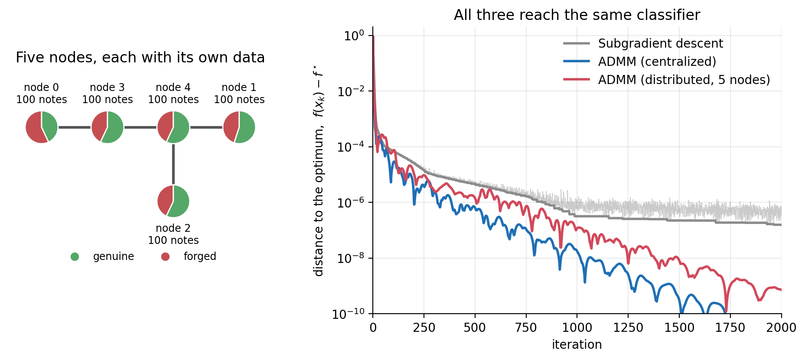
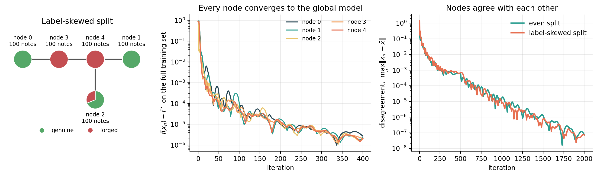
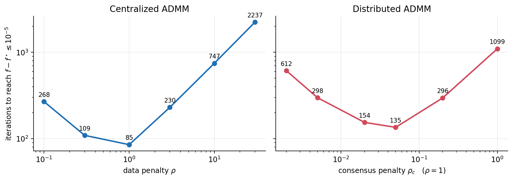

<h1 align="center">Distributed ADMM for support vector machines</h1>

<p align="center">
  <b>Training one classifier across a network of nodes that never share their data</b>
</p>

<p align="center">
  <a href="https://github.com/27pepablo/distributed-admm-svm/actions/workflows/ci.yml"></a>
  
  
  
  <a href="LICENSE"></a>
</p>



<p align="center"><i>
Left: five nodes hold 100 banknotes each and can only talk along the grey links.
Right: distance to the optimal classifier per iteration. The distributed solver (red)
ends at the same solution as the solver that sees all the data at once (blue).
</i></p>

## At a glance

| | |
|---|---|
| **Problem** | Linear soft-margin SVM (hinge loss + L2), a convex but non-smooth problem |
| **Solvers** | Subgradient descent · ADMM · consensus ADMM over an arbitrary network, all written from scratch in NumPy |
| **Key property** | Nodes exchange model parameters with neighbours only: no raw data leaves a node and there is no central server |
| **Data** | Banknote Authentication (UCI): 500 notes for training, 872 held out |
| **Result** | All three solvers reach the scikit-learn optimum (objective gap below 10⁻⁶) and **98.2 %** test accuracy |
| **Check** | Solutions verified against `sklearn.svm.SVC` (libsvm) in the test suite |
| **Stack** | Python · NumPy · SciPy · scikit-learn · Matplotlib · pytest · GitHub Actions |
| **Context** | Course project, *Optimization Techniques for Big Data*, MSc in Signal Theory and Communications, Universidad Politécnica de Madrid |

## Contents

- [The problem](#the-problem)
- [Three solvers](#three-solvers)
- [Results](#results)
- [Quick start](#quick-start)
- [Repository layout](#repository-layout)
- [Data](#data)
- [About this project](#about-this-project)
- [References and license](#references-and-license)

## The problem

Given $N$ samples $a_i \in \mathbb{R}^d$ with labels $y_i \in \lbrace -1, +1 \rbrace$, find the
weights $w$ and intercept $c$ that minimise

$$
f(w, c) \;=\; \frac{1}{N}\sum_{i=1}^{N} \max\bigl(0,\; 1 - y_i\,(a_i^\top w + c)\bigr) \;+\; \frac{\lambda}{2}\,\lVert w \rVert_2^2 .
$$

The hinge loss has a kink, so $f$ is not differentiable and plain gradient descent
does not apply. Now add a second constraint: the samples are spread over several
machines (hospitals, base stations, phones) that are not allowed to pool them. Each
machine can only exchange a handful of numbers with the machines it is directly
connected to. Can they still find the classifier they would have obtained with all
the data in one place?

## Three solvers

| | Subgradient descent | ADMM (centralized) | ADMM (distributed) |
|---|---|---|---|
| **Needs all data in one place** | yes | yes | **no** |
| **Work per iteration** | one pass over the data | one pass + a $(d{+}1)\times(d{+}1)$ solve | the same, at each node, on its own data |
| **Communication** | – | – | each node sends $d{+}1$ numbers to each neighbour |
| **Tuning** | step size and decay | penalty $\rho$ (converges for any $\rho > 0$) | penalties $\rho$, $\rho_c$ (converges for any positive values) |

**ADMM** makes the non-smooth problem easy by splitting it. A copy $s_i$ of every
margin $y_i(a_i^\top w + c)$ is introduced, and the solver alternates between two
steps that both have a closed form: a small linear system for the model (the matrix
is factorised once and reused), and a one-line clipping formula for the margins.

**Distributed ADMM** gives every node its own copy $x_n$ of the model and adds one
shared variable per link of the network that both ends must agree with. The
iteration at a node becomes: solve a small linear system using local data and the
last values agreed with the neighbours, send the result to the neighbours, average.
Agreement spreads through the network link by link until all nodes hold the same
model, which is the minimiser of the global problem.

The full derivation of every update is in [docs/derivations.md](docs/derivations.md).

## Results

Numbers below are produced by [`experiments/run_all.py`](experiments/run_all.py) and
stored in [docs/results.json](docs/results.json). $f^\star$ is the optimum given by
scikit-learn's libsvm solver, refined with 20 000 ADMM iterations (the two differ
by less than $10^{-9}$).

### 1. All three solvers find the same classifier

| Solver | Iterations to $f - f^\star \le 10^{-3}$ | $\le 10^{-5}$ | $\le 10^{-7}$ | Gap after 2000 iterations | Test accuracy |
|---|---:|---:|---:|---:|---:|
| Subgradient descent (step $3/\sqrt{k}$) | 15 | 296 | not reached | $1.6 \times 10^{-7}$ | 98.2 % |
| ADMM, centralized | **9** | **85** | **657** | $4 \times 10^{-12}$ | 98.2 % |
| ADMM, distributed over 5 nodes | 12 | 154 | 778 | $1.2 \times 10^{-10}$ | 98.2 % |

- Distributing the computation costs less than a factor of two in iterations compared
  with the centralized solver, and nothing in accuracy.
- Subgradient descent gets close quickly but then stalls: its step has to shrink
  to keep it from bouncing around the kink (the thin grey line in the figure above),
  and a shrinking step means ever slower progress. ADMM keeps converging at a steady rate.
- On a problem this small every solver reaches a useful classifier within a few dozen
  iterations. What differs is how reliably they get there: the subgradient method only
  works this well after tuning the step size (with a constant step of 0.001 it is still
  0.36 away from the optimum after 1000 iterations).

### 2. Nodes that could not learn alone

The harder test is a **label-skewed split**: the training set is sorted by class
before it is dealt out, so four of the five nodes hold only genuine or only forged
notes. A node like that cannot train any classifier on its own.



Every node still converges to the global model (centre), reaching $10^{-5}$ of the
optimum in 174 iterations against 154 for the even split, with the same 98.2 % test
accuracy. The disagreement between nodes (right) decays at the same rate for both splits.

### 3. Sensitivity to the penalty parameters



ADMM converges for any positive penalty, but the speed varies by more than an order
of magnitude. Too small and the constraints are enforced too slowly; too large and
the iterates barely move. The consensus penalty $\rho_c$ has a wide flat region
(0.02 to 0.05), which makes the distributed solver easy to tune.

### 4. Network topology

With the same label-skewed data on five nodes, changing the shape of the network
changes little: reaching $10^{-5}$ takes 174 iterations on the project tree, 217 on a
path, star or ring, and 180 on a fully connected network with 10 links instead of 4.
On a network this small, information crosses it in two or three hops whatever
the layout, so the extra links are not worth their communication cost.

## Quick start

```bash
git clone https://github.com/27pepablo/distributed-admm-svm.git
cd distributed-admm-svm
pip install -e ".[dev]"

pytest                          # 32 tests, about 10 seconds
python experiments/run_all.py   # regenerates every figure and number above (under a minute)
```

Using the solvers directly:

```python
from admm_svm import load_banknote, admm_distributed, reference_solution, accuracy, graph

data = load_banknote()  # 500 train / 872 test, standardised
problem = data.problem(lam=0.01)

run = admm_distributed(problem, adjacency=graph.ring(8), n_iter=1000)  # any connected network
_, f_star = reference_solution(problem)  # scikit-learn optimum

print(f"gap to optimum : {run.objective[-1] - f_star:.1e}")
print(f"node spread    : {run.consensus_error[-1]:.1e}")
print(f"test accuracy  : {accuracy(run.x, data.A_test, data.y_test):.3f}")
```

`subgradient_descent(problem)` and `admm_centralized(problem)` have the same interface.

## Repository layout

```
src/admm_svm/
  problem.py      objective, subgradient, hinge proximal operator
  solvers.py      subgradient descent, centralized ADMM, distributed consensus ADMM
  graph.py        network topologies, edge lists, algebraic connectivity
  data.py         dataset loading, train/test split, standardisation
  reference.py    independent optimum from scikit-learn
experiments/
  run_all.py      every experiment and figure in this README
tests/            32 tests: hand-computed cases, brute-force prox check, agreement with scikit-learn
docs/
  derivations.md  step-by-step derivation of the ADMM updates
  results.json    numbers behind the tables
  figures/
data/
  banknote.csv    the dataset (46 kB)
```

## Data

[Banknote Authentication](https://archive.ics.uci.edu/dataset/267/banknote+authentication)
from the UCI Machine Learning Repository (V. Lohweg, 2012), licensed CC BY 4.0. Each of
the 1372 rows describes a photo of a genuine or forged banknote with four wavelet
statistics: variance, skewness, kurtosis and entropy. The file is small enough to ship
with the repository. As in the original assignment, 500 shuffled notes are used for
training; the remaining 872 are kept as a test set.

## About this project

This started as my final project for *Optimization Techniques for Big Data* (MSc in
Signal Theory and Communications, UPM, 2025–26). The assignment fixed the problem
(SVM on this dataset, $\lambda = 0.01$), the five-node network, and asked for a
first-order method, ADMM and distributed ADMM.

I rewrote it afterwards as a tested package and fixed what bothered me about the
version I handed in:

- **One problem for all solvers.** The submitted notebook trained the distributed
  solver with an intercept and the other two without, so their objective values were
  not comparable. All three now minimise exactly the same function.
- **A true optimum to measure against.** The notebook measured each solver against the
  best value any of them reached. Distances are now measured to an independently
  computed optimum.
- **Exact ADMM steps.** The notebook solved the model update approximately, with ten
  inner subgradient steps. Splitting on the margins instead makes every step
  closed-form, which is both faster and exactly the algorithm the theory covers.
- **A fair baseline.** Subgradient descent now uses a decaying step, without which it
  does not converge.
- **New experiments.** Held-out accuracy, the label-skewed split, the penalty sweep and
  the topology comparison were not part of the assignment.

The assignment suggested $\rho = 10$. In this formulation the penalty is scaled by
$1/N$ like the loss, and the sweep above shows that $\rho = 1$ is the better choice.

## References and license

- S. Boyd, N. Parikh, E. Chu, B. Peleato, J. Eckstein. *Distributed Optimization and
  Statistical Learning via the Alternating Direction Method of Multipliers.*
  Foundations and Trends in Machine Learning, 2011.
- P. A. Forero, A. Cano, G. B. Giannakis. *Consensus-Based Distributed Support Vector
  Machines.* Journal of Machine Learning Research, 2010.
- V. Lohweg. *Banknote Authentication* [dataset]. UCI Machine Learning Repository, 2012.

Code released under the [MIT License](LICENSE). The dataset keeps its own CC BY 4.0 license.
